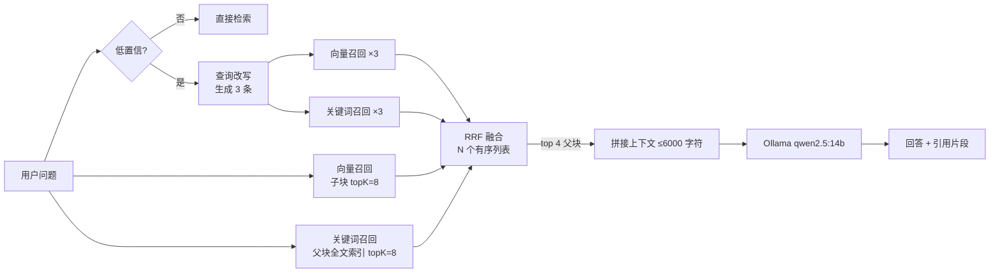

# 企业知识库 RAG 问答系统

<p>
  
  
  
  
  
</p>

上传 PDF 建立私有知识库，提问时**先检索、后生成**，回答严格限制在资料范围内。

检索不是简单的「拿问题去向量库捞 topK」，而是**父子分块 + 向量/关键词多路召回 + RRF 融合**——这是它和「调个 API 套个 RAG」的区别。

<!-- 截图位：跑起来后截一张图放进 docs/，再把下面这行取消注释 -->
<!--  -->

---

## 为什么这么做

单路向量检索有两个绕不过去的弱点：

1. **召回粒度两难**：块切大了，噪声多、相似度被稀释；块切小了，召回准但上下文碎，模型答不全。
2. **精确词失效**：向量擅长语义相近，但「错误码 4021」「`RagController`」这类专有名词、编号、类名，向量经常召不回来。

这个项目对应地做了两件事：**父子分块**解决粒度问题，**多路召回**解决精确匹配问题。

## 核心设计

### 1. 父子分块（small-to-big）

| 层级 | 大小 | 存储 | 作用 |
| --- | --- | --- | --- |
| 子块 | 500 token | Redis 向量库 | 只负责**召回**，越小越准 |
| 父块 | 2000 token | MySQL | 负责**作答**，越大上下文越完整 |

子块命中后，按 `parent_id` 回 MySQL 取父块，再喂给模型。用小块找、用大块答。

> **这里有个坑**：`PagePdfDocumentReader` 是**按页**返回 Document 的，而切分器不会跨 Document 合并。
> 如果直接把 `pages` 丢给切分器，每个父块就只有一页（几百字），大小和子块差不多，
> 父子分块等于没做。所以入库前先把全文拼成一份再切分。
>
> 另外，一条完整条文可能正好跨两个父块。命中后如果发现块尾不是句末标点，
> 会再把同来源的下一个父块接上——只在判断为「被切断」时才扩容，避免无谓地吃上下文预算。

### 2. 多路召回



- **向量路**：`VectorStore.similaritySearch`，阈值 0.6，命中子块后按 `parent_id` 去重。
- **关键词路**：MySQL `FULLTEXT ... WITH PARSER ngram`，中文靠 ngram 切 2-gram，不需要额外的分词服务。
- **融合**：RRF（Reciprocal Rank Fusion），`score = Σ 1 / (60 + rank)`。

> **RRF 融合的是「若干个有序列表」，不是「两个列表」**。每个查询的每条召回路径各算一个列表，
> 分别参与融合。如果把多个查询的结果按查询顺序首尾相接成一个列表再算名次，
> 原问题的第 8 名会排到改写查询的第 1 名前面，而 RRF 只看名次——正确答案会被挤出去。
> 这个 bug 实测出现过：改写查询以 0.87 的相似度命中了正确法条，融合后却被无关条文顶掉了。

> **关键词路是两段式的，这里踩过一个坑**：ngram 在 BOOLEAN 模式下会把一个检索词拆成
> 2-gram 并且要求**全部命中**。直接把整句问话丢进去——「第一百零九条的内容是什么」——
> 其中「条的」「的内」这类相邻 2-gram 在原文里并不存在，于是返回 0 行，
> 表现为「关键词召回 0 条」，检索退化成纯向量。
> 所以先用规则去掉疑问成分得到核心词「第一百零九条」做精确匹配，没命中再退回整句自然语言检索。

### 3. 为什么用 RRF 而不是加权分数

向量路给的是余弦相似度（0~1），关键词路给的是 MySQL 的相关度分数（量纲完全不同，还随文档长度浮动）。**两个分数不能直接相加**，归一化也会因为分布漂移而不稳。

但「名次」是可比的：第一名就是第一名。RRF 只用名次，天然免疫量纲问题，这也是工业界混合检索的默认做法。

### 4. 查询改写：把口语翻译成文档的语言

用户问「有人骗我钱怎么办」，文档里写的是「欺诈」「撤销权」「返还不当得利」——**语义鸿沟**，向量和关键词都够不着。

所以加了一层查询改写，但有三个约束：

1. **只在低置信时触发**。向量最高相似度 < `confident-score` 且关键词 0 命中，才多花一次模型调用；正常问题零额外开销。
2. **提示词里不写任何领域**，领域信息从数据里采样：随机取当前知识库的 3 段正文塞进提示词，模型自己判断这是一批什么文档、用什么术语。同一套代码换到员工手册、产品文档、合同库都能用。
3. **改写结果不单独用**，和原问题一起参与召回，命中同一父块的查询互相"投票"。

> 注意这是**单轮**改写：只把当前这一句口语翻成术语，不看对话历史。所以「那这个呢」这种依赖上文的追问仍然处理不了——那是指代消解，需要把历史一起喂给改写模型。

### 5. 不够可信就拒答

向量检索有个陷阱：**它几乎永远会返回 topK 条**，哪怕全是无关内容。如果直接把结果喂给模型，模型就会拿不相干的法条硬凑答案——这比"没查到"危险得多。

所以加了一道闸：两轮召回后，若既没有精确关键词命中、向量最高相似度也没过线，**直接拒答，不调用生成模型**。

阈值不是拍的，是拿自己的语料实测校准的（`qwen3-embedding:0.6b`，对民法典子块）：

| 问题 | 最高相似度 |
| --- | --- |
| 今天天气怎么样（完全无关） | 0.63 |
| 有人骗我钱怎么办（语义相关但措辞远） | 0.69 |
| 微信转账记录能当证据吗（语料不覆盖） | 0.71 |
| 第一百零九条的内容是什么（精确） | 0.76 |
| 合同什么时候成立（精确） | 0.81 |

`confident-score` 取 **0.75**，落在「边界」（0.71）和「精确命中」（0.76）之间。取 0.72 会正好卡在一条实测样本上——同一句话差 0.01 就从「直接作答」变成「先改写」，行为不稳定。能答的问题过线，答不了的问题触发改写，改写后还过不了线就拒答。这个值在 `application.yml` 里可调，前端每次回答都会显示实际分数，方便按自己的语料重新校准。

### 6. 寒暄不走检索

用户打「你好」，向量检索照样能返回 15 条、最高分 0.73 —— 刚好越过阈值。它区分不了「有意义的匹配」和「embedding 的基线噪声」，所以阈值不能替代意图判断。

这类输入在入口就被短路：不检索、不调模型，直接回一句引导语。

## 功能

- PDF 上传 → 解析 → 文本归一化 → 父子两级切分 → 入库
- 手动录入文本（不传文件也能建库）
- 多知识库隔离：检索时按 `user_id` + `kb_id` 过滤
- 单页对话前端：建库、传文件、提问、查看引用片段
- 另附一个多轮对话页（`/chat.html`）：SSE 流式输出 + `MessageWindowChatMemory` 会话隔离
- 同路失败自动降级：关键词索引没建好时，退回纯向量召回，不影响可用性

## 技术栈

| 层次 | 选型 |
| --- | --- |
| 语言 / 框架 | Java 21、Spring Boot 4.1 |
| AI | Spring AI 2.1、Ollama（qwen2.5:14b + qwen3-embedding:0.6b） |
| 向量库 | Redis Stack（RediSearch），`RedisVectorStore` |
| 关系库 | MySQL 8（父块 + 全文索引） |
| 持久层 | MyBatis-Plus 3.5 |
| 前端 | 原生 HTML + JS（无构建） |

## 快速开始

### 1. 环境要求

- JDK 21+
- MySQL 8
- Redis Stack（**必须带 RediSearch 模块**，普通 Redis 不支持向量检索）
- [Ollama](https://ollama.com/)

### 2. 拉模型

```bash
ollama pull qwen2.5:14b
ollama pull qwen3-embedding:0.6b
ollama serve
```

### 3. 起数据库

```bash
docker compose up -d
```

MySQL 首次启动会自动执行 `docs/schema.sql`。

手动方式：

```bash
mysql -uroot -p < docs/schema.sql
```

### 4. 配置

```bash
cp .env.example .env
```

Windows：

```powershell
Copy-Item .env.example .env
```

项目启动时自动读取根目录 `.env`（见 `application.yml` 的 `spring.config.import`）。

### 5. 启动

```bash
# Linux / macOS
./mvnw spring-boot:run

# Windows
mvnw.cmd spring-boot:run
```

浏览器打开 <http://localhost:8080>。

## 配置项

| 环境变量 | 默认值 | 说明 |
| --- | --- | --- |
| `SERVER_PORT` | `8080` | 服务端口 |
| `DB_URL` | `jdbc:mysql://localhost:3306/rag_kb_db?...` | JDBC 连接串 |
| `DB_USERNAME` / `DB_PASSWORD` | `root` / 空 | 数据库账号 |
| `REDIS_HOST` / `REDIS_PORT` | `localhost` / `6379` | Redis 地址 |
| `OLLAMA_BASE_URL` | `http://localhost:11434` | Ollama 地址 |
| `OLLAMA_CHAT_MODEL` | `qwen2.5:14b` | 对话模型 |
| `OLLAMA_EMBEDDING_MODEL` | `qwen3-embedding:0.6b` | 向量模型（换模型需要重建向量库） |
| `OLLAMA_NUM_CTX` | `8192` | 上下文窗口 |
| `MAX_FILE_SIZE` | `20MB` | 单个 PDF 上限 |

## 接口

| 方法 | 路径 | 说明 |
| --- | --- | --- |
| POST | `/kb/create?userId=&name=` | 新建知识库，返回 kbId |
| GET | `/kb/list?userId=` | 知识库列表 |
| DELETE | `/kb/delete?kbId=&userId=` | 删除知识库（连同父块与向量） |
| POST | `/rag/upload?context=&userId=&kbId=` | 手动录入文本 |
| POST | `/rag/upload-pdf` | 上传 PDF（multipart：file / userId / kbId） |
| POST | `/rag/ask?question=&userId=&kbId=` | 提问 |

提问返回：

```json
{
  "question": "报销流程是什么？",
  "recall": { "vector": 5, "keyword": 3 },
  "answer": "根据资料，报销流程是……",
  "sources": [
    { "parentId": "demo_xxx_0", "file": "员工手册.pdf", "preview": "……" }
  ]
}
```

`recall` 里两路的条数会直接显示在前端，方便观察多路召回是否生效。

## 已知限制

- **未做 rerank**：融合后直接取 topN，加一层交叉编码器精排效果会更好；
- **向量库可能残留孤儿向量**：父块被删除或重传替换后，旧向量未必同步清掉。查询时已按 `parent_id` 回 MySQL 校验并剔除，不会影响答案，但会拖慢检索。彻底清一次可以用：
  `docker exec rag-redis redis-cli EVAL "local ks=redis.call('keys','rag:*'); for i=1,#ks do redis.call('del',ks[i]) end; return #ks" 0`
- **未做多轮指代消解**：`/rag/ask` 是无状态的，追问里的「那这个呢」「它的期限呢」不会被还原成完整问题——查询改写只看当前这一句，不看历史。要支持的话，得把会话历史和当前问题一起交给改写模型；
- **删除跨两个存储**：MySQL 能随事务回滚，Redis 不能，所以顺序是「先删向量、再删表」，没有分布式事务；
- **无鉴权**：`userId` 是查询参数，仅适合本地演示；
- **单机部署**：没有做多实例与任务队列；
- 全文索引依赖 MySQL 的 `ngram` 分词器（5.7.6+ 内置）。

## 项目结构

```
rag-knowledge-base
├── src/main/java/com/example/rag
│   ├── RagApplication.java
│   ├── config          # ChatMemory / RedisVectorStore 构建
│   ├── controller      # 知识库、检索问答、对话
│   ├── entity          # KnowledgeBase / ParentBlock
│   ├── mapper          # MyBatis-Plus + 关键词召回 SQL
│   └── service         # VectorIndexService：按条件批量删向量
├── src/main/resources
│   ├── application.yml
│   ├── static
│   │   ├── index.html                    # 知识库问答
│   │   └── chat.html                     # 多轮对话
├── docs/schema.sql
├── docker-compose.yml
└── .env.example
```

## License

MIT
